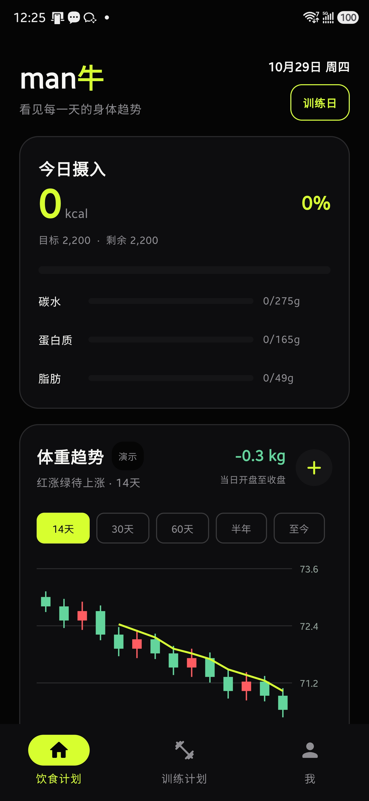
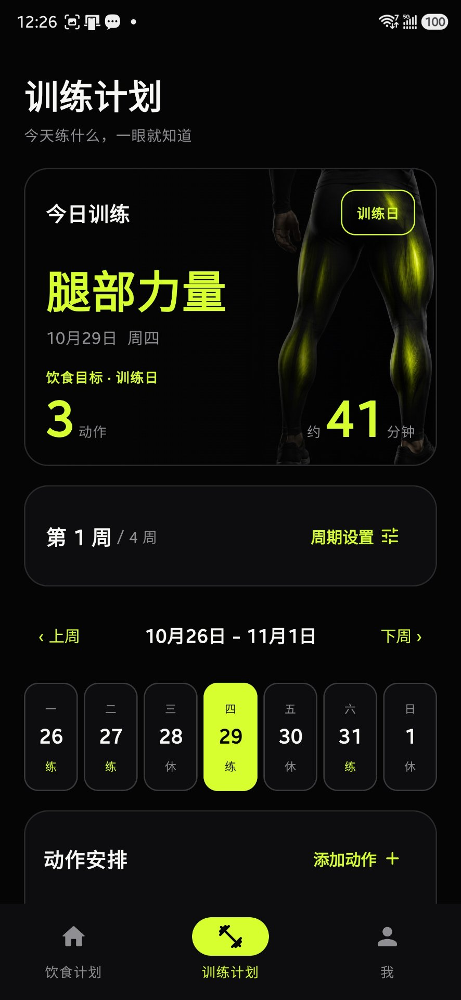
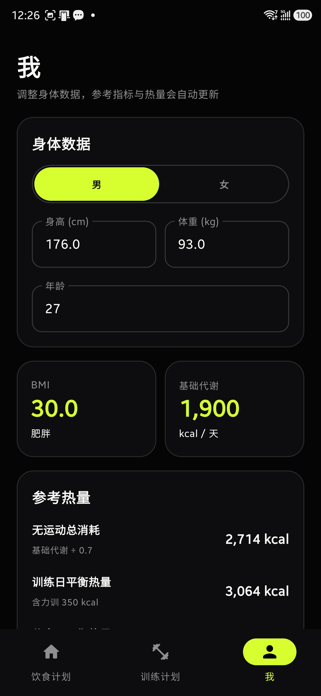

# man牛

**English** | [简体中文](README.md)

[](https://github.com/sinholYip/manniu/actions/workflows/android-ci.yml)
[](LICENSE)
[](https://developer.android.com/about/versions/pie)
[](https://kotlinlang.org)

A dark-themed diet and training log that records body weight as **candlestick charts**, and reads daily calorie intake as their **trading volume**.

One entry per day. Each day's first, last, high and low weight become an OHLC candle, and the calorie bars underneath are its volume. Colors follow the Chinese stock market convention — red for up, green for down — so gaining weight is a red candle and losing is a green one. The whole UI is dark with a lime accent, and everything works fully offline.

## Screenshots

| Diet | Training | Profile |
| :---: | :---: | :---: |
|  |  |  |
| Today's intake progress, weight candles and calorie bars | Training by date, with cycle and muscle-group backdrops | Body metrics, BMI and training-day calorie targets |

Concept art and the interaction checklist live in [`design/`](design/).

## Features

**Weight**

- Aggregated into OHLC candles per day, switchable between 14 days / 30 days / 60 days / 6 months / all time
- Five-day moving average (MA5) drawn in the same color family as the candles
- Tap or long-press and drag to inspect the closing weight and calorie intake for any day
- When a day holds only one entry, the previous close becomes its open

**Diet and calories**

- Five meals — breakfast, lunch, pre-workout, dinner, late night — each logged separately. Calories are computed from carbs × 4 + protein × 4 + fat × 9
- Separate nutrition targets for training days and rest days, with per-meal ratios configurable for each
- Custom food presets per 100 g, auto-scaled to the actual serving weight
- Search Open Food Facts, with built-in offline reference values for common Chinese foods
- Long-press to drag and reorder dashboard sections; layout order travels with backups

**Training**

- Plan any specific date as a training or rest day, across 1–12 week cycles with deload weeks
- Set exercises, sets, reps and weight per day, with a backdrop image for each muscle group
- Personal records (PR) per exercise, plus training volume broken down by muscle group
- The training plan drives that day's nutrition targets directly — no duplicate bookkeeping

**Data**

- Export the full history as JSON in one tap; restore and merge after switching devices or reinstalling
- Every restore is fully validated first — a corrupt file writes nothing at all, and restoring the same backup twice never double-counts
- Shares one backup format with the WeChat Mini Program version

**Language**

- Simplified Chinese and English, switchable at the bottom of the Profile page; follows the system language by default
- Switching never touches your data: exercises and foods stay keyed by their canonical Chinese names, so backups restore across languages
- Long labels never deform a control — the font shrinks first, and only ellipsizes in extreme cases

## Getting started

```bash
git clone https://github.com/sinholYip/manniu.git
cd manniu
./gradlew :app:assembleDebug
```

Requirements — the first two trip people up often, so please double-check them:

| Item | Requirement |
| --- | --- |
| **Project path** | **ASCII only.** A path containing non-ASCII characters makes every unit test fail with `ClassNotFoundException`, while compilation still succeeds |
| Gradle JDK | **21**. Gradle 8.11.1 and AGP 8.9.1 do not support JDK 25, and the default JBR in Android Studio fails the build outright |
| Android SDK | 36 (`compileSdk` / `targetSdk`); devices need Android 9 / API 28 or newer |

To set the JDK: Android Studio → Settings → Build, Execution, Deployment → Build Tools → Gradle → Gradle JDK.

> Avoid keeping the project inside OneDrive, Dropbox or similar sync folders. They fight Gradle over file locks,
> and edits from two machines can overwrite each other.

## Architecture

A single-module Compose app. Sources are split into four layers, and dependencies may only point downward:

```
com.ranke.health
├── MainActivity.kt      Entry point and navigation
├── model/               Data models, enums, derived calculations
├── core/                Side-effect-free calorie and macro conversion
├── data/                Room, local storage, backup, food data sources
└── ui/
    ├── theme/           Colors, type scale, shapes — the design tokens
    ├── components/      Dialogs and form controls shared across screens
    └── screen/          Dashboard, training, profile
```

The dependency direction is `ui → data → core → model`. `model` and `core` have no Android framework dependency,
so plain JVM unit tests cover them directly. The reasoning behind the layering, the data flow, the backup contract,
and the abstractions deliberately left out (ViewModel / dependency injection / multi-module) are documented in
[docs/ARCHITECTURE.md](docs/ARCHITECTURE.md).

```bash
./gradlew :app:compileDebugKotlin   # compile
./gradlew :app:testDebugUnitTest    # unit tests
./gradlew :app:lintDebug            # static analysis
```

## Releases

APKs are large, so they are **not committed to Git** — they ship through GitHub Releases.

```powershell
.\gradlew.bat assembleRelease   # R8 shrinking + resource optimization
.\package-apk.ps1               # copy to bao/man-niu-v<versionName>.apk
.\publish-release.ps1           # create a Release tagged v<versionName> and upload
```

The scripts read GitHub credentials from the `GITHUB_TOKEN` environment variable, falling back to the Git credential
manager (which requires a prior login through GitHub Desktop). All three are idempotent — an existing asset with the
same name is deleted before re-upload.

Before publishing, bump `versionCode` and `versionName` in `app/build.gradle.kts` and add an entry to
[CHANGELOG.md](CHANGELOG.md).

## Data and privacy

The app **uploads nothing**. The only network request it ever makes is to Open Food Facts, and only when you
actively search for a food. Weight, diet, training and settings all live in the app's private directory. There is no
account system, no device identifiers are collected, and no analytics or ad SDK is bundled. Exported backup JSON is
plaintext — keep it safe yourself.

## Multi-device sync

The repository itself is the sync source. On a new machine, just `git clone`.

```bash
git pull --rebase     # pull before you start
# work...
git add -A && git commit -m "message" && git push
```

The following are maintained per machine and **never committed**: `local.properties` (SDK path), `app/build`,
`.gradle`, and `bao/*.apk`. Opening the project in Android Studio for the first time generates `local.properties`
automatically.

## Contributing

Issues and pull requests are welcome. Development conventions, layer ownership, commit message format and the
self-review checklist are in [CONTRIBUTING.md](CONTRIBUTING.md); for security issues see [SECURITY.md](SECURITY.md).

## License

Released under the [MIT License](LICENSE).

- **Copyright belongs to the author** (Copyright © 2026 sinholYip). Open-sourcing does not transfer it.
- You may use, copy, modify, merge, publish, distribute, sublicense and sell this software, **including commercially**,
  without prior permission.
- The only obligation: keep the copyright notice and this license notice in any copy or substantial portion.
- The software is provided "as is", without warranty of any kind, and the author is not liable for any consequences
  of its use.

> The interface concept art in `design/`, the app screenshots in `docs/screenshots/`, and the icons and training
> backdrop images in `app/src/main/res/` are personal visual assets. If you redistribute them, please replace them
> with your own or credit the source.
